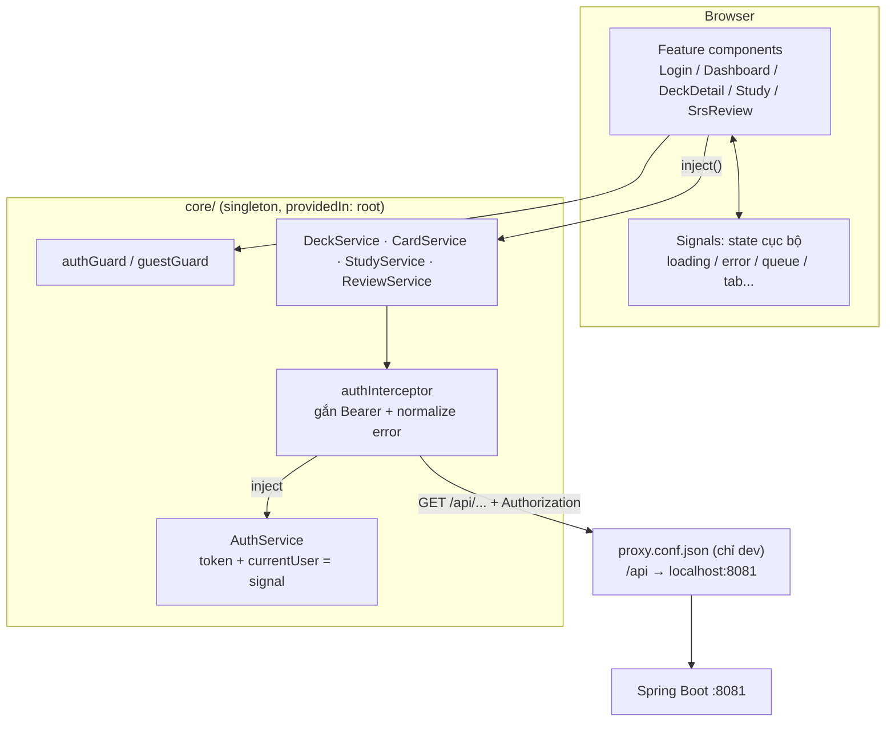

# FE_SOURCE_CODE_GUIDE — Kiến trúc & Luồng xử lý (quizlet_fe)

> Tài liệu phân tích source Angular thực tế của `quizlet_fe` — phục vụ đọc hiểu code, debug và phỏng vấn Fullstack middle.
>
> **Quy ước độ tin cậy:**
> - ✅ **Đã xác minh** — đọc trực tiếp từ source, kèm đường dẫn + dòng.
> - 🔶 **Nhận định kỹ thuật** — suy luận từ source, đánh dấu rõ.
> - ❓ **Chưa đủ bằng chứng** — ghi rõ phần thiếu.

---

## Mục lục

1. [Tổng quan kiến trúc](#1-tổng-quan-kiến-trúc)
2. [Libraries và dependencies](#2-libraries-và-dependencies)
3. [Phân tích cấu trúc source](#3-phân-tích-cấu-trúc-source)
4. [Trace flow UI → Backend endpoint](#4-trace-flow-ui--backend-endpoint)
5. [Các flow nghiệp vụ quan trọng](#5-các-flow-nghiệp-vụ-quan-trọng)
6. [Angular concepts trong source](#6-angular-concepts-trong-source)
7. [Testing, build, deployment](#7-testing-build-deployment)
8. [Code review — vấn đề cần chú ý](#8-code-review--vấn-đề-cần-chú-ý)
9. [Chuẩn bị phỏng vấn](#9-chuẩn-bị-phỏng-vấn)

---

## 1. Tổng quan kiến trúc

### 1.1 Stack đã xác minh

| Thành phần | Giá trị | Bằng chứng |
|---|---|---|
| Angular | `^21.2.0` | `package.json:14-19` |
| TypeScript | `~5.9.2`, `strict: true` + `strictTemplates` | `package.json:31`, `tsconfig.json:12,25` |
| Tailwind CSS | `^4.3.3` (postcss plugin, không có `tailwind.config.js`) | `package.json:20,23`, `src/styles.css:1` |
| RxJS | `~7.8.0` | `package.json:22` |
| Zoneless change detection | `provideZonelessChangeDetection()` | `src/app/app.config.ts:22` |
| Kiểu bootstrap | `bootstrapApplication` (không NgModule) | `src/main.ts:5` |

🔶 **Nhận định:** CLI bị ghim ở 21.x vì môi trường Node 20.19 (Angular CLI mới hơn yêu cầu Node ≥22) — ràng buộc môi trường, không phải lựa chọn kiến trúc.

### 1.2 Cây thư mục

```
quizlet_fe/
├── proxy.conf.json              # Dev proxy: /api → localhost:8081
├── angular.json                 # Builder @angular/build:application; mọi schematics skipTests
├── src/
│   ├── main.ts                  # bootstrapApplication(App, appConfig)
│   ├── styles.css               # @import "tailwindcss" + @theme brand tokens + .flip-* CSS
│   ├── environments/environment.ts   # apiUrl: '' (same-origin, nhờ proxy)
│   └── app/
│       ├── app.ts / app.html    # Shell: header + <router-outlet/>
│       ├── app.config.ts        # providers: zoneless, router, http, locale 'vi'
│       ├── app.routes.ts        # 6 lazy routes + guards
│       ├── core/
│       │   ├── models/          # auth, user, deck, card, study, review — thuần interface
│       │   ├── services/        # AuthService, DeckService, CardService, StudyService, ReviewService
│       │   ├── interceptors/auth.interceptor.ts
│       │   └── guards/auth.guard.ts
│       └── features/
│           ├── auth/{login,register}/
│           ├── dashboard/       # + deck-form-modal (reusable modal)
│           ├── deck/            # deck-detail: CRUD thẻ + SRS enrollment
│           ├── study/           # flip + quiz (MCQ)
│           └── review/          # srs-review: ôn tập SM-2
```

**Convention quan trọng (✅ xác minh từ tên file thực tế):** Angular 17+ không có `.component.ts` — `dashboard.ts` + `dashboard.html` + `dashboard.css`; class tên ngắn không hậu tố (`Dashboard`, `Study`, `SrsReview`). Selector prefix `app-` (`angular.json:39`).

### 1.3 Sơ đồ kiến trúc



**Nguyên tắc phân layer (✅):**
- `features/*` — component, không tự gọi `HttpClient` (chỉ gọi service).
- `core/services/*` — nơi duy nhất gọi HTTP; mỗi service một domain.
- `core/models/*` — hợp đồng dữ liệu, mirror 1:1 JSON backend.
- **Không có store toàn cục** (NgRx/NGXS/SignalStore) — state là signal cục bộ trong component + signal trong `AuthService` (session). ✅ xác minh bằng việc không có dependency nào như vậy trong `package.json`.

### 1.4 Routing

`src/app/app.routes.ts` — toàn bộ **lazy** bằng `loadComponent`, kèm guard:

| Path | Component | Guard |
|---|---|---|
| `/login`, `/register` | `Login`, `Register` | `guestGuard` (đã login → về `/`) |
| `/dashboard` | `Dashboard` | `authGuard` |
| `/decks/:deckId` | `DeckDetail` | `authGuard` |
| `/decks/:deckId/study` | `Study` | `authGuard` |
| `/review` | `SrsReview` | `authGuard` |
| `''` và `**` | redirect → `/dashboard` | — |

`withComponentInputBinding()` (`app.config.ts:23`) — route param `:deckId` được bind thẳng thành `readonly deckId = input.required<number>()` trong component. **Bẫy đã xác minh trong source:** signal input KHÔNG được đọc trong `constructor()` (chưa bind lúc đó → throw, chặn luôn navigation). Cả `DeckDetail.load()` (`deck-detail.ts:130`) và `Study.load()` (`study.ts:200`) đều đọc `deckId()` trong `ngOnInit` qua `load()`.

### 1.5 Authentication / Authorization

- **State:** `AuthService` giữ `token` + `currentUser` là signal, khởi tạo từ `localStorage` (`auth.service.ts:18-21`), key `quizlet_fe.token` / `quizlet_fe.user`.
- **Gắn token:** functional interceptor `authInterceptor` (`auth.interceptor.ts:15-17`) — clone request thêm `Authorization: Bearer`.
- **Chặn route:** `authGuard`/`guestGuard` (`auth.guard.ts`) — trả `UrlTree` (không phải `boolean` + navigate) để router xử lý redirect nguyên tử.
- **Phân quyền UI trong trang:** `DeckDetail.isOwner` computed so `deck.creatorId === auth.currentUser().id` (`deck-detail.ts:41-43`) — ẩn nút Sửa/Xóa; backend vẫn là rào cản cuối (owner-only writes).
- ❓ Không có refresh token, không có cơ chế auto-logout khi 401 giữa phiên — chỉ có messaging.

### 1.6 Error handling — một đường ống duy nhất

```
HTTP error → authInterceptor.catchError → throwError(() => new Error(toMessage(error)))
           → component: error.set(err.message) → template banner đỏ
```

`toMessage()` (`auth.interceptor.ts:24-36`): status 0 → "Cannot reach the server…"; 401 → "Invalid username or password."; parse `error.error.message` của body lỗi Spring (`{timestamp,status,error,message,path}`); fallback `Request failed (status)`. Mọi component chỉ cần đọc `err.message` — **interceptor biến mọi failure thành `Error` có message**.

---

## 2. Libraries và dependencies

✅ Toàn bộ bảng dưới đọc từ `package.json`. Không có lockfile trong repo (❓ không xác định được phiên bản exact — chỉ có range).

### 2.1 Dependencies trực tiếp (runtime)

| Thư viện | Version | Vai trò thực tế trong project | Vấn đề giải quyết | Dùng ở đâu |
|---|---|---|---|---|
| `@angular/core` | ^21.2.0 | Framework: component, signals, DI, zoneless CD | — | mọi file `src/app` |
| `@angular/common` | ^21.2.0 | `HttpClient`, `HttpInterceptorFn`, `DatePipe`, `localeVi` | HTTP + format ngày VN | `auth.interceptor.ts:1`, `dashboard.ts:1`, `app.config.ts:3-4` |
| `@angular/router` | ^21.2.0 | SPA routing, guards, lazy `loadComponent`, input binding | Điều hướng + chặn quyền | `app.routes.ts`, `app.config.ts:23` |
| `@angular/forms` | ^21.2.0 | Reactive Forms (nonNullable, cross-field validator) | Form state + validation | `login.ts:3`, `register.ts:29`, `deck-form-modal.ts`, `deck-detail.ts` |
| `@angular/platform-browser` | ^21.2.0 | `bootstrapApplication` | Bootstrap standalone | `main.ts:1` |
| `@angular/compiler` | ^21.2.0 | Template compiler JIT/AOT | — | (gián tiếp) |
| `rxjs` | ~7.8.0 | `Observable`, `tap`, `map`, `finalize`, `catchError`, `throwError` | Async HTTP stream | mọi service |
| `tailwindcss` + `@tailwindcss/postcss` | ^4.3.3 | Utility CSS; v4 cấu hình bằng CSS (`@theme`) thay JS config | Styling nhanh, token màu brand | `styles.css:1-14`, mọi template |
| `postcss` | ^8.5.29 | Pipeline CSS cho Tailwind v4 | — | build |
| `tslib` | ^2.3.0 | Helpers của TS decorators | — | (gián tiếp) |

### 2.2 DevDependencies

| Thư viện | Version | Vai trò |
|---|---|---|
| `@angular/cli` + `@angular/build` | ^21.2.26 | `ng serve`/`ng build`; builder **application** (esbuild + Vite dev-server) |
| `@angular/compiler-cli` | ^21.2.0 | AOT + `strictTemplates` |
| `typescript` | ~5.9.2 | `strict: true`, `noPropertyAccessFromIndexSignature` |
| `prettier` | ^3.8.1 | Format code |

### 2.3 Vì sao chọn — phân biệt rõ ✅/🔶

- ✅ **Signals thay vì BehaviorSubject/store**: source thực tế không có một `Subject` nào (grep toàn repo: không có `.next(`, không có `async pipe`) — mọi async UI state là `signal` + `subscribe({...})` ghi thẳng vào signal.
- ✅ **Zoneless**: cấu hình tường minh `app.config.ts:22`; CD chỉ chạy khi signal đổi hoặc event — khởi tạo từ scaffold Angular 21.
- 🔶 **Tailwind v4 không config JS**: token `brand-*` định nghĩa trong `@theme` của `styles.css` — chọn theo mặc định của Tailwind v4 + scaffold; giúp tự sinh `bg-brand-600` v.v.
- 🔶 **Không có UI kit** (Angular Material/PrimeNG): mọi UI tự viết bằng utility class — giảm bundle (initial ~286 kB raw), đổi lại tự làm modal/popover.
- ❓ Không có thư viện test nào trong devDependencies (không Jasmine/Vitest/Karma) — xem mục 7.

---

## 3. Phân tích cấu trúc source

### 3.1 Entry point

| File | Trách nhiệm |
|---|---|
| `src/main.ts` | Bootstrap `App` với `appConfig` |
| `src/app/app.config.ts` | Providers: error listeners, **zoneless**, router (+`withComponentInputBinding`), HTTP (+interceptor), `LOCALE_ID = 'vi'` + `registerLocaleData(localeVi)` (ngày hiển thị "10 thg 10") |
| `src/app/app.ts` | Shell: header (brand, nav Đăng nhập/Đăng ký hoặc Ôn tập + user + Đăng xuất) + `<router-outlet/>`; `logout()` clear session rồi về `/login` (`app.ts:16-19`) |

### 3.2 `core/` — services & models

| Class | Trách nhiệm | Ghi chú |
|---|---|---|
| `AuthService` | `login/register/logout`, persist session vào localStorage; expose `token`, `currentUser`, `isLoggedIn` (computed) | Service duy nhất giữ state liên-component; inject trong interceptor, guards, `App`, `DeckDetail` |
| `DeckService` | CRUD deck + `/me` + `/search`; bóc Spring Page: `.pipe(map(page => page.content))` (`deck.service.ts:17,27`) | FE dùng `size=100`, không phân trang |
| `CardService` | CRUD thẻ theo deck | — |
| `StudyService` | `getQuiz` (bóc `.questions`), `submitAnswer` | Không gọi `/progress` hay `/star` (backend có, FE chưa dùng) |
| `ReviewService` | `getDueCards` (bóc `.items`), `submitReview {quality}`, `saveCard`, `enrollDeck`, `removeCard` | Domain SRS |

Models (`core/models/*.ts`): interface thuần, comment ghi nguồn endpoint. Điểm đáng chú ý đã xác minh:
- `Deck.description/category: string | null` — nullable, mọi template phải null-guard (`deck.description || 'Chưa có mô tả.'`).
- `Page<T>` (`deck.model.ts:22-31`) — hình dạng Spring Page để map `.content`.
- `ReviewItem` (`review.model.ts`) — trường `cardId` (không phải `id`), khớp DTO record `DueReviewsResponse.ReviewItemResponse` của backend.

### 3.3 Feature components

| Component | State chính (signals) | Kỹ thuật đáng chú ý |
|---|---|---|
| `Login` / `Register` | `submitting`, `error`, Reactive Form | Cross-field validator `passwordMismatch` (`register.ts:29`); register/login xong **đã có session** (service `tap` lưu) rồi mới navigate |
| `Dashboard` | `tab`, `myDecks`, `publicDecks`, `search`, `visibleDecks` (computed) | Hai cơ chế search khác nhau (mục 5.3); `effect` + `setTimeout` debounce 250ms (`dashboard.ts:55-66`); `isOwner` so theo `myDecks` |
| `DeckFormModal` | `open` = `model.required<boolean>()`, `saved = output<DeckRequest>()` | Two-way binding `[(open)]`; `effect` patchValue khi input `deck` đổi (`deck-form-modal.ts:37-49`); reusable create/edit |
| `DeckDetail` | `deck`, `cards`, `editingCardId`, `savedIds`, `enrolling`... | CRUD thẻ inline-edit; **SRS enrollment**: nút cả deck (`enrollDeck`) + từng thẻ (`toggleReviewQueue`); `savedIds` là state session vì backend không có GET trạng thái đã lưu |
| `Study` | flip: `index/flipped/shuffled`; quiz: `questions/quizIndex/selectedOptionId/lastAnswer/deckProgress/quizFinished` | 2 tab trong 1 component; chấm điểm server-side (FE không biết đáp án trước khi trả lời); keyboard `host: {'(document:keydown)'}` (`study.ts:19`) |
| `SrsReview` | `queue/index/flipped/submitting/finished/loading/error` | `@switch (true)` điều phối 5 trạng thái màn hình; phím Space/Enter lật, 1–4 chấm (`srs-review.ts:94-104`); reuses `.flip-*` CSS toàn cục |

### 3.4 Pattern có thật trong source

- **Smart component + injected service** (không có presentational dumb component trừ `DeckFormModal`).
- **Function-based DI**: `HttpInterceptorFn`, `CanActivateFn` — không class.
- **Bóc wrapper tại service layer**: Spring `Page.content`, quiz `questions`, due `items` — component chỉ thấy mảng phẳng.
- **Config-driven UI**: mảng `ratings: Rating[]` (`srs-review.ts:44-65`) render nút chấm bằng `@for` + `[class]` động.
- 🔶 **State lifting tối thiểu**: chỉ `AuthService` là state chia sẻ; mọi thứ khác cục bộ — đổ lại dữ liệu bằng cách reload (VD `saveDeckChanges()` gọi lại `getDeck`).

---

## 4. Trace flow UI → Backend endpoint

### 4.1 Kiểm kê endpoint FE thực sự gọi (✅ grep từ service layer)

| # | Method + URL | Service method | Component kích hoạt |
|---|---|---|---|
| 1 | `POST /api/auth/register` | `AuthService.register` | `Register.submit` |
| 2 | `POST /api/auth/login` | `AuthService.login` | `Login.submit` |
| 3 | `GET /api/decks/me?size=100` | `DeckService.getMyDecks` | `Dashboard.loadDecks` |
| 4 | `GET /api/decks/search?q=&size=100` | `DeckService.searchPublicDecks` | `Dashboard` effect (debounce) + `loadDecks` |
| 5 | `POST /api/decks` | `DeckService.createDeck` | `Dashboard.saveModal` |
| 6 | `PUT /api/decks/{id}` | `DeckService.updateDeck` | `Dashboard.saveModal` |
| 7 | `DELETE /api/decks/{id}` | `DeckService.deleteDeck` | `Dashboard.deleteDeck` |
| 8 | `GET /api/decks/{id}` | `DeckService.getDeck` | `DeckDetail.load`, `Study.load`, `Dashboard.saveDeckChanges` |
| 9 | `GET /api/decks/{id}/cards` | `CardService.getCards` | `DeckDetail.load`, `Study.load` |
| 10 | `POST /api/decks/{id}/cards` | `CardService.createCard` | `DeckDetail.addCard` |
| 11 | `PUT /api/decks/{id}/cards/{cardId}` | `CardService.updateCard` | `DeckDetail.updateCard` |
| 12 | `DELETE /api/decks/{id}/cards/{cardId}` | `CardService.deleteCard` | `DeckDetail.deleteCard` |
| 13 | `GET /api/decks/{id}/study/quiz?count=10` | `StudyService.getQuiz` | `Study.startQuiz` |
| 14 | `POST /api/decks/{id}/study/answer` | `StudyService.submitAnswer` | `Study.selectOption` / `skipQuestion` |
| 15 | `GET /api/reviews/due?limit=20` | `ReviewService.getDueCards` | `SrsReview.load` |
| 16 | `POST /api/reviews/{cardId}` body `{quality}` | `ReviewService.submitReview` | `SrsReview.rate` |
| 17 | `POST /api/reviews/{cardId}/save` | `ReviewService.saveCard` | `DeckDetail.toggleReviewQueue` |
| 18 | `POST /api/reviews/decks/{deckId}/enroll` | `ReviewService.enrollDeck` | `DeckDetail.enrollDeck` |
| 19 | `DELETE /api/reviews/{cardId}` | `ReviewService.removeCard` | `DeckDetail.toggleReviewQueue` |

**Backend có nhưng FE KHÔNG gọi** (✅ xác minh): `GET /api/decks/{id}/study/progress` (progress chỉ lấy kèm response answer), `POST .../cards/{cardId}/star`, filter `state`/`starred` của quiz, param `category` của search.

### 4.2 Cách URL được ghép

```ts
// mọi service, VD review.service.ts:15
private readonly baseUrl = `${environment.apiUrl}/api/reviews`;
```
`environment.apiUrl = ''` (`environment.ts:4`) → URL tương đối `/api/...` → cùng origin. Dev: Vite dev-server proxy `/api` → `http://localhost:8081` (`proxy.conf.json`, được wire ở `angular.json:81`). Production: FE phải được serve cùng domain với API hoặc đổi `apiUrl` (❓ chưa có file environment.production riêng — build prod vẫn dùng `''`).

Mọi request đều đi qua `authInterceptor` → có JWT nếu đã đăng nhập (kể cả `/decks/search` public).

### 4.3 Trace mẫu — từng dòng chảy

#### A. Đăng nhập

```
User submit form
 → Login.submit (login.ts:27) — form invalid? markAllAsTouched + return
 → AuthService.login(credentials)                     POST /api/auth/login
      body: { usernameOrEmail, password }
      └─ tap(storeSession) (auth.service.ts:28):  localStorage + token.set + currentUser.set
 → interceptor: chưa có token → gửi trần; error 401 → Error('Invalid username or password.')
 → next: router.navigate(['/dashboard'])              (submitting giữ true — điều hướng là rời trang)
 → authGuard thấy isLoggedIn() === true → cho qua
 → app.html render nhánh @else: tên user + nút Ôn tập/Đăng xuất
```
Backend: `AuthController → POST /api/auth/login` (Spring Security, JWT).

#### B. Dashboard — tải + tìm kiếm

```
ngOnInit(class field) → loadDecks (dashboard.ts:115): HAI request SONG SONG
   getMyDecks()      GET /api/decks/me?size=100     → myDecks
   searchPublicDecks GET /api/decks/search?size=100 → publicDecks
Response Page<Deck> → map(page => page.content) → set signal → visibleDecks computed → @for render

User gõ search → search.set(value)
   ├─ tab mine:   visibleDecks (dashboard.ts:31-40) tự tính lại — filter title/category lowercase, (category ?? '')
   └─ tab public: effect (dashboard.ts:55) chạy lại → clearTimeout lịch cũ
                  → setTimeout 250ms → GET /api/decks/search?q=... → publicDecks.set
```
Chi tiết đầy đủ: `docs/SEARCH-FLOW.md`.

#### C. Học MCQ (quiz)

```
Tab Quiz → setTab('quiz') (study.ts:65): quiz rỗng && !quizFinished → startQuiz()
startQuiz: GET /api/decks/{id}/study/quiz?count=10
   response {deckId, direction, questions:[{cardId, prompt(=định nghĩa), options[{cardId,text(=thuật ngữ)}]}]}
   → service map .questions → questions.set → render câu 1

Chọn option → selectOption(cardId) (study.ts:126): guard answered() chống double-submit
   POST /api/decks/{id}/study/answer  body {cardId, selectedCardId, mode:'MULTIPLE_CHOICE'}
   Backend chấm, cập nhật state machine, trả:
   {correct, correctCardId, correctTerm, state, consecutiveCorrect, deckProgress}
   → lastAnswer.set + deckProgress.set
   → optionState(cardId) (study.ts:175) tô xanh/đỏ theo correctCardId/selectedOptionId
   → nextQuestion(): hết câu → quizFinished → màn % thành thạo (deckProgress giữ giá trị cuối)
Bỏ qua → skipQuestion: cùng endpoint, selectedCardId: null → backend tính SAI
```

#### D. Ôn tập SRS

```
/review (authGuard) → SrsReview.ngOnInit → load (srs-review.ts:116)
   GET /api/reviews/due?limit=20 → {dueCount, serverTime, items:[ReviewItem]} → map .items → queue.set
@switch (true) (srs-review.html:2):
   error / loading / finished / queue rỗng (☕) / default: thẻ hiện tại

Bấm thẻ hoặc Space → flip() → flipped=true → hiện 4 nút chấm (@if flipped)
Chấm 1–4 → rate(score) (srs-review.ts:75):
   guard !card || submitting
   POST /api/reviews/{cardId}  body {quality: 1|2|3|4}
   next: advance() — index+1 & unflip, hoặc finished.set(true) → 🎉
   error: error.set + submitting=false (cho chấm lại)
```

#### E. Enrollment SRS từ deck-detail

```
"Đưa vào ôn tập" → enrollDeck (deck-detail.ts) → POST /api/reviews/decks/{deckId}/enroll
   → {totalCards, newlyEnrolled, alreadyEnrolled} → enrollMessage (banner + link /review)
"+ Lưu ôn tập" từng thẻ → toggleReviewQueue:
   chưa có trong savedIds → saveCard (POST /{cardId}/save) — idempotent, saved:false = đã có sẵn
   đã có trong savedIds → removeCard (DELETE /{cardId}) → 204
```

### 4.4 Bảng trace nhanh các flow còn lại

| Flow | Chuỗi file đọc theo thứ tự |
|---|---|
| Đăng ký | `register.html` (form) → `register.ts:32` (validator, submit) → `auth.service.ts:31` → `auth.interceptor.ts` → backend `AuthController` → `storeSession` → `/dashboard` |
| CRUD deck (modal) | `dashboard.html` (nút) → `deck-form-modal.ts` (effect patch + output) → `dashboard.ts:87 saveModal` → `deck.service.ts:34/38` → modal tự đóng, `saveModal` cập nhật `myDecks` |
| CRUD thẻ | `deck-detail.html` (form add/inline edit) → `deck-detail.ts:97/114` → `card.service.ts` → update `cards` signal cục bộ |
| Xóa deck | `dashboard.html` nút Xóa → `dashboard.ts:105` `confirm()` → DELETE → filter khỏi `myDecks` |

**Loading/error convention (✅ đồng nhất mọi component):** `loading = signal(true)` + `finalize(() => loading.set(false))`; `error = signal<string|null>` render banner `border-red-200 bg-red-50`. Retry: `SrsReview.restart()`, `Study.startQuiz()` — không có auto-retry nào.

---

## 5. Các flow nghiệp vụ quan trọng

### 5.1 Authentication & session persistence

1. **User** điền form → 2. **Login/Register** validate (required/minLength/cross-field) → 3. `AuthService` POST → 4. **`tap` side-effect** lưu localStorage + signal ngay khi response về → 5. navigate.
- **Edge case đã xử lý:** `restoreUser()` try/catch JSON hỏng (`auth.service.ts:57-65`); guard 2 chiều.
- **Edge case còn hở:** không route nào kiểm tra token hết hạn — JWT chết → mọi API 401 → interceptor biến thành message "Invalid username or password." (sai ngữ nghĩa — xem mục 8).

### 5.2 Study MCQ — state machine nằm ở server

- FE **không tự chấm**: gửi `selectedCardId`, tin `correct`/`correctCardId` từ response. Đáp án không bao giờ có sẵn ở client trước khi trả lời (backend cố ý như vậy — chống cheat).
- `deckProgress` chỉ đến **kèm từng câu trả lời** — FE không gọi `/progress` riêng → màn hình kết quả thể hiện snapshot cuối.
- Edge case: deck < 4 thẻ → FE chặn trước (`study.html:126-136`) vì quiz cần 4 option; skip = sai (backend quy ước).

### 5.3 Search hai chế độ (đặc thù đáng kể nhất)

Cùng 1 input, 2 cơ chế — chi tiết đầy đủ ở `docs/SEARCH-FLOW.md`:
- **mine:** lọc tức thời client-side (đã có sẵn 100 deck).
- **public:** debounce 250ms server-side; `effect` cleanup bằng `clearTimeout`; query rỗng = bỏ param `q`.
- Edge case: response về lệch thứ tự có thể ghi đè kết quả mới hơn (chưa có `switchMap`/AbortController — 🔶 rủi ro thấp nhưng có thật).

### 5.4 SRS review + enrollment

- **Chốt chặn UI:** nút chấm chỉ xuất hiện sau khi lật; `submitting` khóa trong lúc POST; phím số chỉ có tác dụng khi `flipped()`.
- **Idempotent enrollment:** dùng chính response `saved:false` làm "probe" khi không có GET trạng thái; `savedIds` chỉ đúng trong session (f5 mất) — chấp nhận được vì backend idempotent.
- Edge case: `AGAIN` không quay lại ngay trong phiên (hẹn +10 phút) — hàng đợi là snapshot lúc load.

### 5.5 Modal create/edit dùng chung

`DeckFormModal` — 1 component 2 chế độ: input `deck()` null = create; `effect` patchValue + `?? ''`/`?? 'Khác'` cho nullable; `output<DeckRequest>` để **parent** quyết định gọi create hay update (`dashboard.ts:87-93`) — modal không biết gì về HTTP. Sau save parent reload deck (`saveDeckChanges`) thay vì patch phức tạp.

---

## 6. Angular concepts trong source

| Concept | Có ở đâu (✅) | Ghi chú |
|---|---|---|
| Standalone component | mọi component — không có `NgModule` nào | Bootstrap bằng `bootstrapApplication` |
| Signals | `signal/computed/input/model/output/effect` — gần như mọi file ts | `model.required` ở `deck-form-modal.ts:22` |
| Zoneless CD | `app.config.ts:22` | Không import `zone.js` dựa trên scaffold; CD bấn vào signal/event |
| `input.required` + `withComponentInputBinding` | `deck-detail.ts:26`, `study.ts:27` | Route param → input; phải đọc trong `ngOnInit` |
| Functional guard/interceptor | `auth.guard.ts`, `auth.interceptor.ts` | Trả `UrlTree` từ guard |
| Lazy `loadComponent` | `app.routes.ts` toàn bộ route | Mỗi trang 1 chunk (build log: study 14 kB, srs-review 8 kB...) |
| Control flow mới `@if/@for/@switch` | mọi template | `@switch (true)` ở `srs-review.html:2`; `@for (…; track …)` bắt buộc track |
| Reactive Forms | Login/Register/DeckFormModal/DeckDetail | `fb.nonNullable.group`, `getRawValue()`, `markAllAsTouched()`, cross-field validator |
| RxJS | `tap`(AuthService), `map`(bóc wrapper), `finalize`(loading), `catchError/throwError`(interceptor) | **Không dùng:** Subject, async pipe, `takeUntilDestroyed`, `switchMap`, resolver |
| State management | signal cục bộ + AuthService signal | Không store library |
| `host` binding | `(document:keydown)` ở `study.ts:19`, `srs-review.ts:19` | Keyboard global, guard theo tab/flipped |
| i18n locale | `app.config.ts:4-5,26` `LOCALE_ID='vi'` | `DatePipe` format "d MMM, y" tiếng Việt |
| Lifecycle | Chủ yếu `ngOnInit`; `constructor` dùng cho effect đăng ký (Dashboard) | Không có `OnChanges/OnDestroy` nào |
| **Không sử dụng** | NgModule, directive tự viết, pipe tự viết, resolver, prefetch, SSR, `ChangeDetectorRef` | Ghi rõ để khỏi nói thừa khi phỏng vấn |

**Subscription cleanup (quan trọng):** các `subscribe` HTTP **không** được hủy khi component chết. Với HTTP ngắn rủi ro thấp (request tự hoàn tất), nhưng: (a) callback `setTimeout` 250ms của search có thể bắn sau khi rời Dashboard → gọi API + `set()` lên component đã hủy; (b) `finalize` vẫn chạy. 🔶 Ở chế độ zoneless hiện tại không gây lỗi hiển thị, nhưng là kỹ thuật cần khai đúng khi phỏng vấn.

---

## 7. Testing, build, deployment

### 7.1 Testing — thực trạng: chưa có

- `angular.json:11-35`: **mọi schematic đặt `skipTests: true`** → không có file `.spec.ts` nào (✅ `find src -name "*.spec.ts"` = rỗng).
- `package.json` không có Jasmine/Vitest/Karma/Jest trong devDependencies → script `"test": "ng test"` (`package.json:9`) **hiện không chạy được** vì thiếu runner.
- Không có thư mục e2e, không có Playwright/Cypress.
- ✅ Cách kiểm chứng thực tế duy nhất đang dùng: `npx ng build` (biên dịch AOT + strictTemplates) và test tay qua proxy với backend thật.

### 7.2 Build

| Lệnh | Ý nghĩa |
|---|---|
| `npm start` → `ng serve` | Dev server + proxy 8081, HMR |
| `npm run build` → `ng build` | Production mặc định (`defaultConfiguration: "production"`, `angular.json:76`) |
| `npm run watch` | Build dev liên tục |

- Builder `@angular/build:application` — esbuild. Budget: initial warn 500 kB / error 1 MB; component style 4 kB/8 kB (`angular.json:56-66`). `outputHashing: all` cho cache-busting.
- Output: `dist/quizlet-fe`.

### 7.3 Environment & deployment

- Chỉ có **một** file `src/environments/environment.ts` (`apiUrl: ''`) — không có `environment.production.ts`, không cấu hình file-replacement trong `angular.json` (✅ mục `configurations.production` chỉ có budgets + hashing). → Prod đang ngầm **giả định FE được phục vụ cùng origin với API** (reverse proxy style).
- Dev proxy chỉ tồn tại ở `ng serve` — build ra không mang proxy.
- ❓ **Không có Dockerfile, docker-compose, `.github/` (CI), hay script deploy trong repo FE** (đã kiểm tra). Backend có Jenkins ở :8080 theo docs nhưng không liên quan cấu hình FE.

---

## 8. Code review — vấn đề cần chú ý

Mỗi mục: **vị trí (✅) → tác động → mức độ → hướng cải thiện**. Tách bạch "lỗi xác nhận được" và "đề xuất".

### Nhóm lỗi xác nhận được

| # | Vấn đề | Vị trí | Tác động | Mức |
|---|---|---|---|---|
| 1 | **Sai type trong error handler**: `error: (err: HttpErrorResponse)` nhưng interceptor đã `throwError(() => new Error(...))` — err thực tế là `Error`, không phải `HttpErrorResponse` | `login.ts:38`, `register.ts:44` | Đánh lỘ认 đọc code; runtime vẫn chạy vì chỉ đọc `.message` | Thấp |
| 2 | **Ánh xạ 401 cứng thành "Invalid username or password."** — mọi 401 (kể cả token hết hạn giữa phiên) đều hiện thông báo đăng nhập sai | `auth.interceptor.ts:27` | UX/messaging sai ngữ nghĩa sau khi JWT hết hạn | Vừa |
| 3 | **Không auto-logout khi 401** — token chết không bị dọn, user phải tự đoán | `auth.interceptor.ts` (không có nhánh logout) | Kẹt trong app với mọi API fail | Vừa |
| 4 | **Search race**: response cũ về sau có thể ghi đè kết quả mới | `dashboard.ts:60-65` (setTimeout, không `switchMap`/AbortController) | Kết quả search lệch (hiếm, debounce 250ms giúp giảm) | Thấp |
| 5 | **Timer không clear khi hủy component** — `searchTimer` bắn sau khi rời trang, vẫn gọi API + set signal component chết | `dashboard.ts:46,59-65` (không có `OnDestroy`/`takeUntilDestroyed`) | Leak nhẹ, request thừa | Thấp |
| 6 | **Subscription không hủy** toàn app (mọi `.subscribe` không có scope hủy) | toàn bộ component | Như trên; tăng dần nếu app lớn | Thấp–Vừa |
| 7 | **Cứng `size=100`, không phân trang** — >100 deck/thẻ công khai bị cắt im lặng | `deck.service.ts:16,22` | Dữ liệu "mất" không báo lỗi | Vừa |
| 8 | **`ng test` không chạy được** — không có runner trong devDependencies, không có spec | `package.json:9`, `angular.json:11-35` | Không có an toàn hồi quy | Vừa |

### Nhóm đề xuất cải thiện (🔶 nhận định kỹ thuật)

- **Error signal dùng chung** trong `DeckDetail`/`Dashboard` — lỗi của enrollment ghi đè lỗi load dữ liệu; tách banner theo ngữ cảnh sẽ rõ hơn.
- **`savedIds` chỉ sống trong session** (`deck-detail.ts`) — nếu muốn hiển thị đúng trạng thái "đã lưu" sau f5 cần backend bổ sung GET (chưa có bằng chứng endpoint này tồn tại).
- **Token trong localStorage** — chuẩn trade-off XSS; nếu nâng cấp: HttpOnly cookie + CSRF, hoặc ít nhất thêm expiry check.
- **`confirm()` native** cho xóa — OK cho MVP, thiếu testability.
- **Không có `trackBy` tách bạch cho dữ liệu lớn / virtual scroll** — vô nghĩa ở quy mô 100, chỉ lưu ý khi mở rộng.

---

## 9. Chuẩn bị phỏng vấn

### 9.1 18 câu hỏi + trả lời ngắn (bám đúng source này)

1. **Kiến trúc state của app là gì, vì sao không dùng NgRx?**
   → Signal cục bộ mỗi component + `AuthService` giữ session (signal + computed). Quy mô nhỏ, data không chia sẻ chéo nhiều màn hình → store là over-engineering. ✅
2. **Zoneless hoạt động thế nào trong project này?**
   → `provideZonelessChangeDetection()`; CD kích hoạt khi signal ghi/event DOM/router — không có `zone.js`. ✅
3. **Route param vào component bằng cách nào?**
   → `withComponentInputBinding` + `input.required<number>()`; phải đọc trong `ngOnInit`, không đọc trong constructor (input bind sau khi constructed — bẫy thật của project). ✅
4. **Interceptor làm 2 việc gì?**
   → Clone request gắn `Authorization: Bearer`; normalize mọi lỗi thành `Error(message)` để component chỉ đọc `.message`. ✅
5. **Vì sao interceptor phải ném `new Error(...)` thay vì string?**
   → RxJS `error` nhận giá trị bất kỳ, nhưng handler trong project đọc `err.message` — ném string làm message `undefined`, bug thật đã từng gặp. ✅
6. **Guard trả `boolean` hay gì?**
   → `UrlTree` (`router.createUrlTree(['/login'])`) — router xử lý redirect nguyên tử, tránh race navigate thủ công. ✅
7. **Lazy loading được làm thế nào, không phải module?**
   → `loadComponent: () => import(...).then(m => m.Dashboard)` per-route, standalone. ✅
8. **Debounce search implement thế nào? (không dùng RxJS operator)**
   → `effect` đọc `search()` → `clearTimeout` lịch cũ → `setTimeout(250)`. Trade-off: không hủy request đang bay (thiếu `switchMap`). ✅
9. **Tại sao tab "Bộ của tôi" không gọi API khi search?**
   → Dữ liệu đã tải (`/decks/me`, size=100) → lọc computed tại chỗ, tức thì; public data phải server-side vì không tải hết. ✅
10. **Spring Page được xử lý thế nào ở FE?**
    → Interface `Page<T>` mirror JSON, service `map(page => page.content)` — component chỉ thấy `Deck[]`. ✅
11. **Reactive Form: cross-field validation?**
    → Validator cấp group so `password === confirmPassword` trả `{passwordMismatch: true}` (`register.ts:29`); `nonNullable.group` + `getRawValue()` lấy type chuẩn. ✅
12. **Chống double-submit?**
    → Signal `submitting`/`answered` khóa nút; hoặc guard đầu hàm (`if (this.submitting()) return`). ✅
13. **Quiz chấm điểm ở đâu, vì sao?**
    → Server (`POST /answer` trả `correct`) — đáp án không gửi xuống client trước khi trả lời, chống xem đáp án qua DevTools. ✅
14. **Model hai tiến trình học (MCQ vs SRS) tách nhau thế nào ở FE?**
    → Hai service (`StudyService`/`ReviewService`), hai model, hai bảng state ở backend; FE chỉ gọi đúng URL domain. ✅
15. **Keyboard shortcuts gắn thế nào?**
    → `host: {'(document:keydown)': 'onKeydown($event)'}`, trong handler guard theo tab/flipped + `preventDefault` cho Space. ✅
16. **Locale tiếng Việt cấu hình đâu, tác động gì?**
    → `registerLocaleData(localeVi)` + `{provide: LOCALE_ID, useValue: 'vi'}` — `DatePipe` render "10 thg 10, 2026". ✅
17. **3D flip card CSS hoạt động thế nào?**
    → `.flip-scene` perspective; `.flip-card` `preserve-3d` + `rotateY(180deg)` khi `.is-flipped`; hai mặt `backface-visibility: hidden`, mặt sau pre-rotate 180° (`styles.css:26-46`). ✅
18. **Nếu phải thêm phân trang thì chạm đâu?**
    → `Page<T>` đã có metadata (`totalPages`…); thêm state `page` + params ở `DeckService`, UI nút chuyển trang; backend đã trả Page sẵn. 🔶

**Câu hỏi đào sâu thêm:** trait `finalize` vs `complete` trong loading; vì sao `effect` đặt trong constructor; signals vs BehaviorSubject (project không có Subject nào — nói đúng sẽ ghi điểm); cách mock HTTP cho test sau này (`provideHttpClientTesting`).

### 9.2 Câu trả lời trung thực cho phần chưa có bằng chứng ownership

- Repo FE **không phải git repository** (✅ kiểm tra) → không chứng minh được ai commit gì. Câu trả lời an toàn: *"Tôi xây dựng/duy trì codebase này (scaffold Angular 21) với quy trình có trợ giúp AI; tôi có thể giải thích từng dòng vì đã trace toàn bộ flow."* — rồi chứng minh bằng kiến thức trong chính tài liệu này (bẫy `input.required`, contract bóc Page, lý do `new Error` trong interceptor).
- Không khai "đã viết unit test" — hiện trạng không có test (mục 7.1). Nói: *"Test là phần tôi biết đang thiếu, kế hoạch là Vitest + `provideHttpClientTesting`."*

---

## Phụ lục — Thứ tự đọc source đề xuất (onboarding 1 buổi)

1. `src/main.ts` → `app.config.ts` → `app.routes.ts` (khung app)
2. `core/services/auth.service.ts` + `core/interceptors/auth.interceptor.ts` + `core/guards/auth.guard.ts` (xương sống auth)
3. `features/auth/login/login.ts` (mẫu component chuẩn: form + signal + service)
4. `features/dashboard/dashboard.ts` (pattern phức tạp nhất: computed + effect + debounce + 2 nguồn dữ liệu)
5. `features/deck/deck-detail.ts` (CRUD + enrollment, component lớn nhất)
6. `features/study/study.ts` → `features/review/srs-review.ts` (2 chế độ học)
7. `styles.css` (theme + flip), `proxy.conf.json`, `angular.json` (build)

## Tóm tắt-capacity

- **Đã phân tích:** 100% file TS/HTML/CSS của `src/app` (21 file), toàn bộ config (`package.json`, `angular.json`, `tsconfig`, `proxy.conf.json`, `environment.ts`, `styles.css`, `index.html` qua scaffold chuẩn), 21 endpoint FE gọi + 3 endpoint backend FE chưa dùng.
- **Chưa xác minh được:** lockfile (phiên bản exact), git history/ownership (không phải git repo), hành vi production deploy (không có cấu hình), backend nội bộ ngoài các controller đã đọc (AuthController/DeckController/CardController/StudyController/ReviewController + service impl liên quan).
